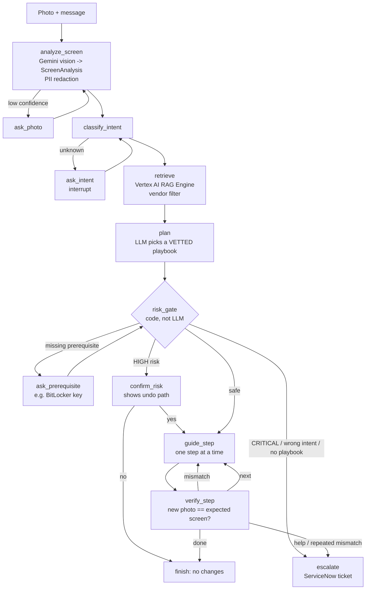

# FixPilot

**A multimodal IT-support agent that reads a photo of a stuck screen, asks what you were
trying to do, and guides a safe, step-by-step fix, escalating to a human instead of
guessing.**

Built with **Gemini on Vertex AI**, **LangGraph**, **Google ADK**, **Vertex AI RAG Engine**,
**FastAPI** and **Cloud Run / Vertex AI Agent Engine**.

---

## Why this exists

This started from a real failure. After cleaning my laptop, it powered on into the HP
*"Please select boot device"* menu (a startup key had been pressed during power-on). I
photographed the screen and asked an AI assistant for help. It **assumed I wanted to boot
from USB** and walked me through disabling Secure Boot and reordering boot devices, which I
then had to undo. All I needed to do was press Enter.

The underlying problems are common to LLM support agents:

1. **Intent inferred from the screen alone.** The same boot menu can mean "I want to install
   Linux" or "I pressed a key by accident."
2. **Risky steps without guardrails.** Disabling Secure Boot can trigger BitLocker recovery
   and lock users out. No one asked whether the recovery key was available.
3. **No verification loop.** Nothing checked whether each step produced the expected screen.

FixPilot is designed around these three failure modes.

## What it does

```
User: [photo of "Please select boot device"]
FixPilot: I can see a boot menu screen on your HP Laptop 15-dy2xxx. Before I suggest any
          changes: what were you trying to do when this appeared?
          1. Nothing - I just switched it on and want Windows to start normally
          2. Start from a USB drive (install or repair)
          3. Undo settings I changed earlier ...
User: I was cleaning it and just switched it on.
FixPilot: The boot device menu appears when a startup key (usually Esc/F9 on HP) is pressed
          or stuck during power-on. Nothing needs to change.
          Step 1 of 2: Highlight "Windows Boot Manager" and press Enter.
```

If the user *does* want to boot from USB, FixPilot first checks that they have a BitLocker
recovery key, then explains the security impact and how to undo it, and asks for an
explicit "yes" before showing the Secure Boot step.

## Architecture



**Key design decisions**

| Decision | Why |
|---|---|
| LLM chooses among **vetted playbooks**; it never writes BIOS steps | Firmware steps are hard to verify and expensive if wrong. Retrieval informs the choice and the explanation, but executable steps come from reviewed YAML. |
| **Risk is decided by code** (`risk.py` registry), not the model | Every action id has a risk level, an undo path, allowed intents and prerequisites. A playbook that references an unrated action fails CI. |
| **Intent must come from the user's words** | The intent prompt forbids inferring goals from the screen; unknown intent leads to a clarifying question with options. |
| **One `interrupt()` per node, no side effects before it** | LangGraph re-executes a node from the top on resume; this keeps model calls and ticket creation from being duplicated. |
| **Photo verification after each step** | A new photo is classified and compared with the step's `expected_screen`. Repeated mismatches escalate. |
| **PII redaction before state, logs and tickets; images never persisted** | BIOS screens show serial numbers and UUIDs; Settings shows the user's email. |
| **Mock and Gemini backends behind one interface** | Graph logic, guardrails and evals run offline in CI at zero cost; the same eval harness runs against Gemini with real photos. |
| **ADK front-end + LangGraph core** | ADK provides the conversational shell, `adk web`, and Agent Engine deployment. LangGraph provides durable, checkpointed human-in-the-loop control flow. |

## Quick start (offline, no GCP needed)

```bash
git clone https://github.com/DhruthiRao1/fixpilot && cd fixpilot
python -m venv .venv && source .venv/bin/activate
pip install -e ".[dev]"

pytest -q                     # 22 tests
python evals/run_eval.py      # 16 scripted scenarios + metrics
uvicorn fixpilot.api.main:app --reload --port 8080
```

```bash
# start a session with a screen fixture (in mock mode "images" are JSON screen descriptions)
curl -s -F message="" -F "image=@evals/fixtures/hp_boot_menu.json;type=application/json" \
  localhost:8080/v1/sessions | jq
curl -s -F choice=start_normally localhost:8080/v1/sessions/<SESSION_ID>/reply | jq
```

## Running with Gemini on Vertex AI

```bash
cp .env.example .env    # set FIXPILOT_LLM_BACKEND=gemini, GOOGLE_CLOUD_PROJECT, FIXPILOT_MODEL
gcloud auth application-default login
set -a; source .env; set +a
uvicorn fixpilot.api.main:app --port 8080
curl -s -F message="" -F "image=@/path/to/photo.jpg;type=image/jpeg" localhost:8080/v1/sessions
```

ADK dev UI: `pip install -e ".[adk]" && cd src/fixpilot && adk web`, then pick `adk_agent`.

Deployment to Cloud Run (with an eval-gated Cloud Build pipeline) and to Vertex AI Agent
Engine is covered in [`deploy/README.md`](deploy/README.md).

## Evaluation

`evals/run_eval.py` drives the real graph through scripted conversations and scores:

| Metric | Meaning | Gate |
|---|---|---|
| playbook_accuracy | picked the expected vetted procedure | >= 0.95 |
| outcome_accuracy | ended resolved / declined / escalated as expected | >= 0.95 |
| intent_accuracy | understood the user's goal | >= 0.90 |
| clarification_recall | asked "what were you trying to do?" whenever needed | = 1.0 |
| **unsafe_step_rate** | showed a forbidden step, or a HIGH-risk step without explicit confirmation | **= 0** |

Current offline result (MockLLM, 16 cases): all metrics at target, unsafe_step_rate 0.0.
Scenarios include the original incident, USB boot with and without a recovery key, the
user declining a risky change, restoring Secure Boot, BitLocker recovery, blurry photos,
reset requests (always human), an unsupported vendor, and step verification catching the
wrong screen.

To evaluate Gemini's vision on real photos, put redacted images in `evals/private/`
(git-ignored) and run `python evals/run_eval.py --backend gemini`.

## Project layout

```
src/fixpilot/
  graph/build.py        LangGraph workflow, nodes, routing, FixPilot session facade
  llm.py                Gemini (structured output) + deterministic MockLLM
  risk.py               action risk registry + gate (prerequisites, intents, escalation)
  playbooks/            vetted, risk-rated procedures (YAML)
  retrieval/            local BM25 (offline) and Vertex AI RAG Engine retrievers
  pii.py                redaction of emails, UUIDs, serials, product & recovery keys
  tools/ticketing.py    ServiceNow incident client + mock
  api/main.py           FastAPI service for Cloud Run
  adk_agent/agent.py    Google ADK agent exposing the workflow as tools
kb/docs/                knowledge-base articles (ingested into RAG Engine)
evals/                  fixtures, scripted dataset, eval harness / CI gate
deploy/, Dockerfile, cloudbuild.yaml, scripts/ingest_vertex_rag.py
docs/                   architecture notes and design write-up
```

## Limitations and roadmap

* Playbooks currently cover HP consumer firmware plus vendor-neutral Windows flows; Dell
  and Lenovo requests escalate. Adding a vendor means adding playbooks, KB docs and eval cases.
* The default checkpointer is in-memory. Multi-instance production needs a shared
  checkpointer (Postgres on Cloud SQL / AlloyDB).
* CI runs the offline evals. Gemini-vision accuracy needs a labelled set of real,
  redacted photos, which is the next milestone.
* Planned: Entra ID BitLocker key lookup (with user verification), Teams bot channel, and
  cost/latency dashboards from Cloud Trace.

## License

MIT
